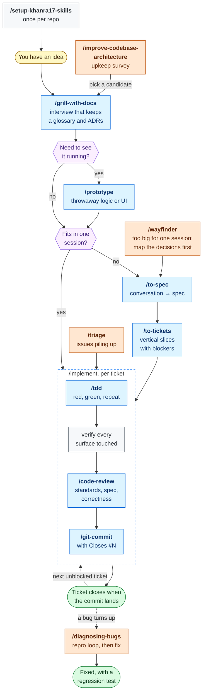

# Skills For Real Engineers

[](https://skills.sh/khanra17/skills)

The agent skills I use every day to do real engineering, not vibe coding.

Adapted from [Matt Pocock's skills](https://github.com/mattpocock/skills), customized by khanra17. See [LICENSE](./LICENSE) for the MIT terms and copyright notices.

Developing real applications is hard. Approaches like GSD, BMAD, and Spec-Kit try to help by owning the process. In doing so they take away your control, and a bug in the process becomes hard to fix.

These skills are small, easy to adapt, and composable. They are written for current frontier models and rest on long-standing engineering practice. Edit them until they fit how you work.

## Installation

Use [skills.sh](https://skills.sh/khanra17/skills) with pi, Codex, Antigravity, or another supported agent. The installer lets you choose which skills to install and for which agents.

### 1. Get the skills

**Productivity: install globally.**

```bash
npx skills@latest add khanra17/skills --global --skill grill-me grilling handoff reflect teach unslop wait-what writing-for-agents
```

For a project-specific copy, run the same command from the project without `--global`.

**Engineering: install per project.** Run these from the project directory:

```bash
npx skills@latest add khanra17/skills/skills/engineering --skill '*'
npx skills@latest add khanra17/skills --skill grilling unslop writing-for-agents
```

The first command installs the engineering set, including `setup-khanra17-skills` and `triage`. The second installs the productivity skills the engineering flows call: `grilling` for interviews, `unslop` for human-facing writing, and `writing-for-agents` for project instructions. With both, the engineering flows work without a global installation.

The installed files are yours to edit. Update when you want with `npx skills update`.

### 2. Run `/setup-khanra17-skills`

Run it once per repo for the engineering skills. Productivity skills need no setup. It will:

- Ask which issue tracker you use: GitHub, local files, or another tracker you describe
- Ask whether to keep the default triage labels (`/triage` works through labels)
- Write the guide that tells skills where the glossary and ADRs live, confirming the layout for multi-context repos
- Draft stack-aware `AGENTS.md` guidance for your approval
- Confirm the Gitmoji + Conventional Commits convention and record where your repository differs
- Offer a GitHub Project for delivery tracking, which small projects can skip

### 3. Start with `/which-skill`

Describe what you are trying to do and it names the skill or flow to use.

## Workflow

Most work travels one route, from an idea to a closed ticket. The other skills are ways onto that route, or run inside it.



Blue boxes are the main route. Orange boxes are the other ways in: each joins the route where its arrow lands. Purple boxes are the two decisions that shape the route.

Two links are left out of the picture to keep it readable:

- `/diagnosing-bugs` points you to `/improve-codebase-architecture` when a bug has no seam to test at.
- A prototype that would crowd the planning session is built in a fresh one, with `/handoff` carrying the question out and the verdict back.

**Running inside the route.** The agent reaches for these when the work calls for them, and you can type them too.

| Skill | Where it shows up |
| --- | --- |
| `grilling` | The interview inside `grill-with-docs`, `triage`, `wayfinder`, and architecture reviews |
| `glossary`, `adr` | Whenever a domain term or an architectural decision gets settled |
| `codebase-design` | When a module's shape is the question, in `tdd` and architecture work |
| `research` | When a decision waits on outside facts, including `wayfinder`'s research tickets |
| `technical-writing`, `unslop` | Docs, and issue or PR descriptions |
| `github-project` | When issues change and when `implement` starts and finishes, if you opted in to a board |
| `wizard` | When a step needs you: credentials, dashboards, cutovers |

**Any time.** These sit outside the route.

| Skill | Use it to |
| --- | --- |
| `which-skill` | Ask what to run next |
| `grill-me` | Get the interview with no repo and no files written |
| `handoff` | Move work to another session, harness, or person |
| `wait-what` | Have the last message explained again |
| `reflect` | Turn a session's lessons into instruction changes |
| `teach` | Learn a topic, in one answer or over many sessions |
| `writing-for-agents` | Write skills and `AGENTS.md` |

Every skill is linked in the [Reference](#reference) below.

## Why These Skills Exist

These skills address common failure modes with Claude Code, Codex, and other coding agents.

### #1: The Agent Didn't Do What I Want

> "No-one knows exactly what they want"
>
> David Thomas & Andrew Hunt, [The Pragmatic Programmer](https://www.amazon.co.uk/Pragmatic-Programmer-Anniversary-Journey-Mastery/dp/B0833F1T3V)

**The Problem**: The most common failure mode in software development is misalignment. You think the dev knows what you want. Then you see what they built, and you realize they didn't understand you at all.

The same gap exists between you and an agent. The fix is a **grilling session**: the agent asks you detailed questions about what you're building until nothing is left assumed.

**The Fix** is to use:

- [`/grill-with-docs`](./skills/engineering/grill-with-docs/SKILL.md) inside a project. It also records the terms and decisions you settle (see #2)
- [`/grill-me`](./skills/productivity/grill-me/SKILL.md) for anything with no repo under it

Run one before you make a change, so you and the agent agree on it first.

### #2: The Agent Doesn't Speak The Project's Language

> With a ubiquitous language, conversations among developers and expressions of the code are all derived from the same domain model.
>
> Eric Evans, [Domain-Driven-Design](https://www.amazon.co.uk/Domain-Driven-Design-Tackling-Complexity-Software/dp/0321125215)

**The Problem**: At the start of a project, devs and the people they're building for (the domain experts) speak different languages.

Agents have it worse. They are dropped into a project and left to work out the jargon as they go, so they use 20 words where 1 would do, and name the same thing three ways across the code.

**The Fix** is a shared language: a glossary that defines the project's terms once.

<details>
<summary>
Example
</summary>

A project's `GLOSSARY.md` defines shared terms (see the [glossary docs](./docs/engineering/glossary.md)). In a course-management app, which description is easier to read?

- **BEFORE**: "There's a problem when a lesson inside a section of a course is made 'real' (i.e. given a spot in the file system)"
- **AFTER**: "There's a problem with the materialization cascade"

</details>

[`/grill-with-docs`](./skills/engineering/grill-with-docs/SKILL.md) builds this as you go. It is a grilling session that also writes each term you settle into the glossary and records hard-to-explain decisions as ADRs.

> [!TIP]
> A shared language does more than shorten messages:
>
> - Variables, functions and files get named consistently
> - The codebase becomes easier for the agent to navigate
> - The agent spends fewer tokens thinking, because it has a concise word for each concept

### #3: The Code Doesn't Work

> "Always take small, deliberate steps. The rate of feedback is your speed limit. Never take on a task that’s too big."
>
> David Thomas & Andrew Hunt, [The Pragmatic Programmer](https://www.amazon.co.uk/Pragmatic-Programmer-Anniversary-Journey-Mastery/dp/B0833F1T3V)

**The Problem**: You and the agent agree on what to build, and the result still doesn't work.

Look at your feedback loops. An agent that can't see how its code runs is working blind.

**The Fix**: Give it the usual feedback loops: static types, browser access, and automated tests.

- [`/tdd`](./skills/engineering/tdd/SKILL.md) works one red-green slice at a time: a failing test, then just enough code to pass it. It carries guidance on what makes a test worth keeping.
- [`/code-review`](./skills/engineering/code-review/SKILL.md) checks the finished change against your standards, the spec, and for bugs.
- [`/diagnosing-bugs`](./skills/engineering/diagnosing-bugs/SKILL.md) handles the hard failures: it builds a command that reproduces the bug before it forms any theory about the cause.

### #4: We Built A Ball Of Mud

> "Invest in the design of the system _every day_."
>
> Kent Beck, [Extreme Programming Explained](https://www.amazon.co.uk/Extreme-Programming-Explained-Embrace-Change/dp/0321278658)

> "The best modules are deep. They allow a lot of functionality to be accessed through a simple interface."
>
> John Ousterhout, [A Philosophy Of Software Design](https://www.amazon.co.uk/Philosophy-Software-Design-2nd/dp/173210221X)

**The Problem**: Most apps built with agents are complex and hard to change. Because agents can radically speed up coding, they also accelerate software entropy. Codebases get more complex at an unprecedented rate.

**The Fix** for this is a radical new approach to AI-powered development: caring about the design of the code.

This is built in to every layer of these skills:

- [`/to-spec`](./skills/engineering/to-spec/SKILL.md) quizzes you about which modules you're touching before creating a spec

And crucially, [`/improve-codebase-architecture`](./skills/engineering/improve-codebase-architecture/SKILL.md) surveys a codebase for deepening opportunities and hands you the candidates. I recommend running it on your codebase once every few days. It is a survey, not a rescue: on a genuinely old codebase it will find real candidates, but it won't untangle the mud for you.

### Summary

Software engineering fundamentals matter more than ever. These skills are my best effort at condensing these fundamentals into repeatable practices, to help you ship the best apps of your career. Enjoy.

## Reference

These split on one axis: who can invoke them. **User-invoked** skills are reachable only when you type them (e.g. `/grill-me`); their job is to orchestrate. **Model-invoked** skills can be invoked by you _or_ reached for automatically by the agent when the task fits; they hold the reusable discipline. A user-invoked skill may invoke model-invoked skills, but never another user-invoked one.

### Engineering

Skills I use daily for code work.

**User-invoked**

- **[ask-matt](./skills/engineering/ask-matt/SKILL.md)**: Ask which skill or flow fits your situation. A router over the user-invoked skills in this repo.
- **[grill-with-docs](./skills/engineering/grill-with-docs/SKILL.md)**: Grilling session that also builds your project's domain model, sharpening terminology and updating `GLOSSARY.md` and ADRs inline.
- **[triage](./skills/engineering/triage/SKILL.md)**: Move issues through a state machine of triage roles.
- **[improve-codebase-architecture](./skills/engineering/improve-codebase-architecture/SKILL.md)**: Scan a codebase for deepening opportunities, present them as a visual HTML report, then grill through whichever one you pick.
- **[setup-matt-pocock-skills](./skills/engineering/setup-matt-pocock-skills/SKILL.md)**: Configure this repo for the engineering skills (issue tracker, triage labels, domain doc layout). Run once per repo before using the other engineering skills.
- **[to-spec](./skills/engineering/to-spec/SKILL.md)**: Turn the current conversation into a spec and publish it to the issue tracker. No interview, just synthesizes what you've already discussed.
- **[to-tickets](./skills/engineering/to-tickets/SKILL.md)**: Break any plan, spec, or conversation into a set of tracer-bullet tickets, each declaring its blocking edges, written as text in a local file, or as native blocking links on a real tracker.
- **[implement](./skills/engineering/implement/SKILL.md)**: Build the work described by a spec or set of tickets, driving `/tdd` at pre-agreed seams and closing out with `/code-review` before committing.
- **[implement-spec](./skills/engineering/implement-spec/SKILL.md)**: Implement a whole spec on one integration branch. Works the tickets as a task graph, running implementer subagents across the ready frontier for maximum concurrency, then closes out with `/code-review`.
- **[wayfinder](./skills/engineering/wayfinder/SKILL.md)**: Plan a huge chunk of work, more than one agent session can hold, as a shared map of decision tickets on the issue tracker, and resolve them one at a time until the way to the destination is clear.
- **[retro](./skills/engineering/retro/SKILL.md)**: Suggest improvements to the coding agent's environment (navigation, automated checks, coding standards, steering files, tooling) after a session, most severe first.

**Model-invoked**

- **[prototype](./skills/engineering/prototype/SKILL.md)**: Build a throwaway prototype to answer a design question, either a single shareable HTML file for state/logic questions, or several radically different UI variations toggleable from one route.
- **[diagnosing-bugs](./skills/engineering/diagnosing-bugs/SKILL.md)**: Disciplined diagnosis loop for hard bugs and performance regressions: build a feedback loop that goes red on this bug → minimise → hypothesise → instrument → fix → regression-test.
- **[research](./skills/engineering/research/SKILL.md)**: Investigate a question against high-trust primary sources and capture the findings as a cited Markdown file in the repo, run as a background agent.
- **[tdd](./skills/engineering/tdd/SKILL.md)**: Test-driven development with a red-green-refactor loop. Builds features or fixes bugs one vertical slice at a time.
- **[domain-modeling](./skills/engineering/domain-modeling/SKILL.md)**: Actively build and sharpen a project's domain model: challenge terms against the glossary, stress-test with edge-case scenarios, and update `GLOSSARY.md` and ADRs inline.
- **[codebase-design](./skills/engineering/codebase-design/SKILL.md)**: Shared discipline and vocabulary for designing deep modules: a lot of behaviour behind a small interface, placed at a clean seam, testable through that interface.
- **[code-review](./skills/engineering/code-review/SKILL.md)**: Two-axis review of the diff since a fixed point: **Standards** (does it follow the repo's coding standards, plus a Fowler smell baseline?) and **Spec** (does it faithfully implement the originating issue/spec?), run as parallel sub-agents so neither pollutes the other.
- **[pr](./skills/engineering/pr/SKILL.md)**: The shape a pull request body should take: a summary as the smallest visual that makes the change clear, before/after evidence that it works, and a merge-danger call (one-way or two-way door, plus blast radius).
- **[wizard](./skills/engineering/wizard/SKILL.md)**: Generate an interactive bash wizard that walks a human through steps only they can perform: provisioning infrastructure, setting up credentials or CI secrets, walking an unfamiliar third-party dashboard, or running a one-off migration or cutover.

### Productivity

General workflow tools, not code-specific.

**User-invoked**

- **[grill-me](./skills/productivity/grill-me/SKILL.md)**: Get relentlessly interviewed about a plan or design until every branch of the design tree is resolved.
- **[handoff](./skills/productivity/handoff/SKILL.md)**: Compact the current conversation into a handoff document so another agent can continue the work.
- **[teach](./skills/productivity/teach/SKILL.md)**: Teach the user a new skill or concept over multiple sessions, using the current directory as a stateful teaching workspace.
- **[to-questionnaire](./skills/productivity/to-questionnaire/SKILL.md)**: Turn a decision you can't answer alone into a Markdown questionnaire for the one person who can, filled in async, or together over a meeting. It grills you about the send (who it's for, what you need back), not the subject.
- **[wait-what](./skills/productivity/wait-what/SKILL.md)**: Fire this the moment a message doesn't land. The agent re-pitches it with the context you're missing, in plain English, using your `GLOSSARY.md` vocabulary.

**Model-invoked**

- **[grilling](./skills/productivity/grilling/SKILL.md)**: Interview the user relentlessly about a plan, decision, or idea until every branch of the design tree is resolved. The reusable interview primitive behind `grill-me`, `grill-with-docs`, `triage`, `wayfinder` and `improve-codebase-architecture`.
- **[writing-for-agents](./skills/productivity/writing-for-agents/SKILL.md)**: Writing documents for agents: skills, AGENTS.md/CLAUDE.md, and any doc an agent reaches by a pointer.
